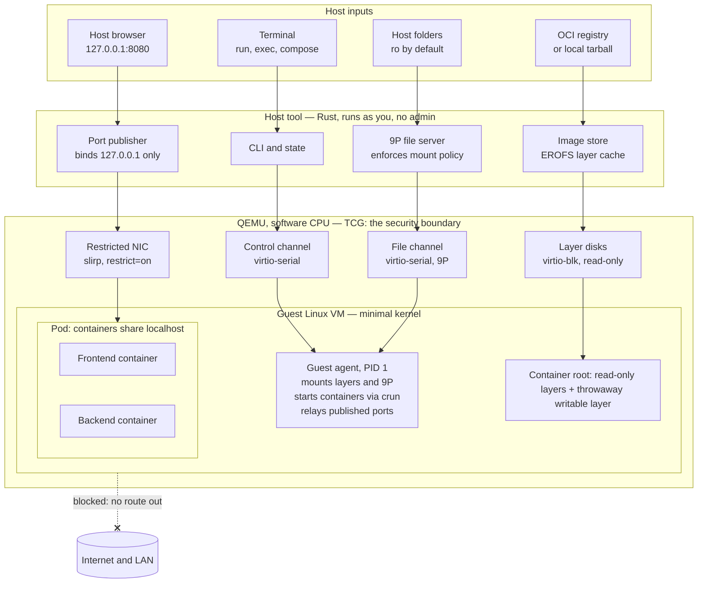

# oci-hermit — Design

Status: draft, 2026-11-15

## Summary

Build a single-binary tool that runs prebuilt OCI images inside a software-emulated Linux sandbox on Linux, Windows and macOS. It needs no root, no admin rights, no hardware virtualization and no WSL. Each sandbox is a small emulated VM: images are unpacked on the host without privileges, handed to the guest as read-only disks, and started by crun inside the guest. Networking is sealed: no egress, and ingress only through ports the user publishes on the host's 127.0.0.1.

**Goals**

- Test prebuilt container images on locked-down laptops where Docker, Podman machines and WSL are unavailable.
- Strong isolation: the guest never runs directly on the host CPU and has no route out.
- A Docker/Podman-style CLI, including a Compose subset for frontend-plus-backend apps.
- One portable codebase, written in Rust.

**Non-goals**

- Building images. `npm install`, `pixi install` and similar run before the image reaches this tool.
- Native-speed or production workloads.
- Bridge or host networking, privileged containers, device passthrough.

## Requirements and constraints

| Requirement | Decision |
| --- | --- |
| Host platforms | Linux, Windows, macOS (x86-64 and arm64 hosts) |
| Privileges | None: no root, no admin, no installer drivers |
| Hardware virtualization | Not required; pure software CPU emulation |
| WSL | Not used |
| Egress | Blocked, always |
| Ingress | Only explicitly published ports, bound to 127.0.0.1 |
| In-sandbox networking | Loopback works; containers in one pod share localhost |
| Images | Prebuilt OCI images: registry pull, OCI layout or tarball |
| Workloads | Smoke-testing images: web frontends and backends, interactive shells |
| Host folders | Bind mounts allowed, read-only by default |
| CLI | Mirrors Docker and Podman commands |

## Architecture

Each sandbox is one emulator process that the host tool launches as the user. Every path into the guest passes through a host-tool component and a single virtio device, and there is no path out.



Read it top to bottom: inputs reach the host tool, each host-tool component speaks to the guest through one device, and the guest agent wires those devices into the pod. The QEMU process is the security boundary.

## Components

**Host tool (Rust, single binary).** Owns everything on the host side and is the only process the user runs.

- CLI front end and a small state store (images, containers, pods) under the user's data directory.
- Image store: pulls and verifies images from registries, or loads OCI layouts and tarballs offline.
- Layer builder: turns each layer into a read-only EROFS disk image, cached by digest.
- Sandbox supervisor: launches and monitors one emulator process per sandbox, applies CPU and memory limits.
- Control client: talks to the guest agent over virtio-serial.
- 9P file server: serves bind-mounted folders and enforces the mount policy.
- Port publisher: listens on 127.0.0.1 and relays connections into the guest.

**Emulator (bundled QEMU, TCG mode).** A helper process launched by the host tool. oci-hermit builds it itself, TCG-only, and refuses any other QEMU ([qemu/README.md](../qemu/README.md)).

- `microvm` machine type, virtio devices only: block disks, one network card, serial channels, console.
- Multi-threaded TCG so a sandbox can have several vCPUs.
- Emulates x86-64 or arm64 guests on any host, so `--platform` works everywhere.

**Guest kernel.** A minimal Linux kernel built by the project: virtio, overlayfs, EROFS, 9P, namespaces and cgroups. Nothing else. It is the newest LTS release, configured from `tinyconfig` plus committed fragments; see [guest/README.md](../guest/README.md).

**Guest agent (Rust, static, PID 1).**

- Boots as init: mounts `/proc`, `/sys`, devtmpfs on `/dev`, devpts, and tmpfs on `/run` and `/tmp` (an already-mounted target is skipped), logs line-oriented `hermit-agent: ...` messages to the console, and reaps orphaned children.
- Never exits: on a shutdown request or any fatal setup error it logs, syncs and powers the VM off, because a PID 1 that exits or panics panics the kernel. Until the control protocol carries a shutdown message, the request is SIGTERM or SIGINT; the agent logs a `ready` line with the protocol version once it is waiting. Run anywhere other than as PID 1 on Linux, it refuses to start.
- A static binary per guest architecture (`pixi run -e agent agent-build`, x86-64 and arm64). It is static glibc (`crt-static`, conda-forge's 2.39 sysroot) rather than musl, because conda-forge ships no musl Rust standard library.
- Mounts the layer disks and builds an overlayfs root with a throwaway writable layer.
- Mounts bind-mounted folders over 9P.
- Generates OCI runtime bundles and starts containers with crun.
- Handles exec, PTYs, logs, signals and exit codes for the host tool.
- Runs containers of one pod in a shared network namespace.

**Image pipeline.** pull or load → verify digests → per-layer EROFS image (cached) → attached read-only to the VM → stacked with overlayfs in the guest. The host never mounts anything, so no privileges are needed.

## Networking

The sandbox has no egress at all. The only way in is a port the user publishes, and it is bound to the host's 127.0.0.1.

- **Starting point:** QEMU user-mode networking (libslirp) with `restrict=on`. The guest cannot reach the host or anything beyond it, and explicit forwarding rules still work. `-p 8080:80` becomes a forward from `127.0.0.1:8080` on the host to port 80 in the guest.
- **Inside the sandbox:** loopback works normally. Containers in one pod share a network namespace, so a frontend reaches its backend on `localhost`.
- **Binding rule:** published ports bind to 127.0.0.1 even when the user asks for `0.0.0.0`. Exposing to the LAN would need an explicit opt-in flag, not in the first release.
- **Stronger later option:** remove the guest NIC entirely. The guest agent accepts relayed connections over virtio-serial and connects to the container's port on loopback. With no network device, there is no network stack exposed to the guest.
- **Image pulls** happen in the host tool only. The guest never sees registry credentials or a route out.
- **Failure is a feature:** an image that tries to download things at runtime fails, which proves it isn't self-contained.

## Filesystem and bind mounts

The container root is an overlay of read-only image layers plus a throwaway writable layer, discarded when the container is removed. Host folders can be bind-mounted, read-only unless the user says otherwise.

**Mechanism.** The host tool runs its own 9P server and carries it over a virtio-serial channel. The guest agent mounts it with the Linux 9P client in `trans=fd` mode, then bind-mounts it into the container. The same code works on all three host OSes, and every file operation passes through code the project controls.

**Mount policy, enforced by the 9P server:**

- Read-only by default. `-v ./src:/app` is read-only; writing needs `:rw`. This is a deliberate difference from Docker.
- No escaping the shared root: `..`, outward symlinks and Windows junctions are refused. On Linux, `openat2` with `RESOLVE_BENEATH` does this in the kernel.
- Deny-list of sources: drive roots, the whole home folder, `~/.ssh`, `~/.aws`, `~/.kube`, `~/.docker` and OS credential stores.
- No device nodes, FIFOs or sockets. Setuid bits and host ownership are ignored; files appear owned by the container user.
- Every active mount and its mode is shown in `oci-hermit inspect` and `oci-hermit ps`.

**Syntax** follows Docker: `-v src:dst[:ro|:rw]` and `--mount type=bind,src=,dst=,readonly`. Compose `volumes:` entries follow the same rules. Named volumes come later.

**Documented trade-off:** an `:rw` mount is an intentional hole. Anything the container writes there lands on the host.

## CLI and Compose subset

Commands mirror Docker and Podman so existing habits carry over. `oci-hermit` is the binary name. An optional short alias, `ohm`, can be installed for daily use. No bare `hermit` binary is shipped, to avoid clashing with Cash App's Hermit on a user's PATH.

```bash
# Images (host side)
oci-hermit pull ghcr.io/org/app:1.2
oci-hermit load -i app.tar            # docker-archive or OCI layout
oci-hermit images | rmi | inspect | image prune

# Containers
oci-hermit run -it --rm alpine sh
oci-hermit run -d --name web -p 127.0.0.1:8080:80 -v ./data:/data app:1.2
oci-hermit exec -it web sh
oci-hermit logs -f web
oci-hermit ps -a | stop | rm | cp

# Pods (shared localhost, like podman pod)
oci-hermit pod create --name shop -p 8080:3000
oci-hermit run -d --pod shop backend:1.0
oci-hermit run -d --pod shop frontend:1.0

# Compose subset
oci-hermit compose up -d
oci-hermit compose down

# Sandbox details
oci-hermit machine info
```

**Deliberate differences from Docker**

| Area | Behaviour |
| --- | --- |
| `-p` | Always binds to 127.0.0.1 |
| `--network` | Only `none` and pod-shared; no bridge or host |
| Refused flags | `--privileged`, `--cap-add`, `--device`, host PID or IPC namespaces |
| `-v` | Read-only unless `:rw` |
| `--cpus`, `--memory` | Size the emulated VM |
| Compose | `services`, `image`, `ports`, `environment`, `command`, `depends_on`, `healthcheck`, `volumes`; `build:` rejected |

A Compose project runs as one pod in one sandbox VM.

## Security model

The security boundary is the emulator process: guest code never runs directly on the host CPU, and it can only touch the devices the emulator provides. Defence in depth comes from keeping that boundary small and locking down the process around it.

**Layers, outermost first**

1. **Host OS sandbox around the emulator,** using unprivileged features: seccomp and Landlock on Linux, App Sandbox on macOS, an AppContainer or low-integrity token on Windows.
2. **Software CPU emulation (TCG).** No hypervisor or kernel driver on the host.
3. **Minimal device model:** virtio block, serial and (initially) one restricted NIC. No USB, graphics, sound or shared clipboard.
4. **Guest kernel** separating the container from the agent.
5. **Container namespaces and cgroups** inside the guest, via crun.

**What the guest can reach:** its own read-only layer disks, its writable layer, published-port connections coming in, and bind-mounted folders under the mount policy. Nothing else.

**Host-side code** is Rust, removing most memory-safety bugs from the parts that parse guest input (9P, control protocol, port relay).

**Supply chain:** image digests are verified on pull. Signature verification (cosign or notation) is a later milestone. Release binaries are code-signed on Windows and macOS.

## Performance expectations

Software emulation is slower than native, but the target workloads are light because images arrive fully built.

| Activity | Expectation |
| --- | --- |
| Sandbox start | Seconds, not sub-second; to be measured in milestone 1 |
| Interactive shell | Responsive |
| Web frontend and backend under test traffic | Acceptable for smoke tests |
| CPU-heavy work (compiles, large data loads) | Several times to more than 10x slower than native; out of scope |

Levers if needed: layer caching, a pre-booted kernel snapshot, and more vCPUs through multi-threaded TCG.

## Prior art

No existing tool combines rootless, no-hypervisor, cross-platform and a Docker-style UX.

| Project | What it does | Gap for this use |
| --- | --- | --- |
| [container2wasm](https://github.com/ktock/container2wasm) | Converts an image to Wasm that runs Linux and the container on an emulated CPU | Experimental; per-image conversion; no Docker-style CLI |
| [Blink](https://github.com/jart/blink) | Unprivileged user-space emulator for x86-64 Linux binaries | Forwards syscalls to the host, so no sandbox; Windows only via Cygwin without JIT |
| VirtualBox | Full VMs | Software virtualization removed in [6.1](https://docs.oracle.com/en/virtualization/virtualbox/6.1/relnotes/rn-features.html); needs VT-x or Hyper-V and admin-installed drivers |
| Podman rootless | Native rootless containers | Linux only; needs a VM on Windows and macOS |
| Lima, Podman machine, Docker Desktop | Linux VM for containers | Need a hypervisor; some need admin or WSL |

## Packaging, risks and open questions

**Packaging decision:** a standalone tool, published on conda-forge so `pixi global install`, `pixi add` and `conda install` all work. It is not a pixi extension, because its audience is anyone testing images and it ships its own emulator, kernel and agent. A thin `pixi-oci-hermit` shim or a pixi-oci hook can add a build-then-smoke-test flow later.

**Risks**

| Risk | Mitigation |
| --- | --- |
| Endpoint allow-listing (AppLocker, Defender) blocks an unsigned emulator on corporate laptops | Code-signed releases on Windows and macOS from the first release |
| QEMU is GPL-2.0 | Ship it as a separate helper process, not linked into the host tool; publish its source |
| 9P over virtio-serial is too slow for large bind mounts | Prototype early; fall back to QEMU's built-in 9P where it works |
| Emulation too slow for some test suites | Scope to smoke tests; document limits; measure in milestone 1 |
| Guest-to-emulator escape bugs | OS sandbox around the emulator; minimal device model; track QEMU security fixes |

**Open questions**

- [x] conda-forge has no system-emulation QEMU for macOS or Windows, so oci-hermit builds its own minimal one ([qemu/README.md](../qemu/README.md)).
- [ ] Keep libslirp long-term, or move to the NIC-less relay design?
- [x] Project name: oci-hermit (free on conda-forge, crates.io, PyPI, npm and GitHub as of 2026-11-15).
- [ ] Signature verification: cosign, notation, or both?

## Milestones

See [ROADMAP.md](../ROADMAP.md).
